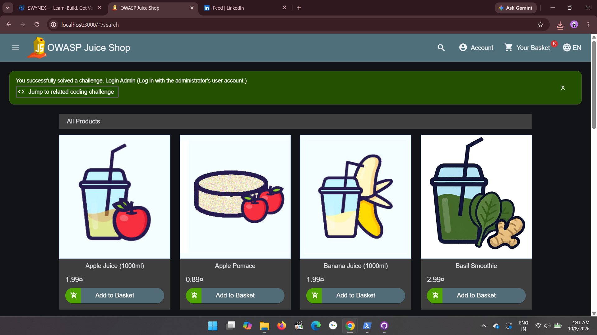

# SWYNEX Security Fundamentals Assessment

Security assessment performed in an authorized lab environment for the SWYNEX Cyber Security Internship.

## Lab Environment
- **Target:** OWASP Juice Shop (intentionally vulnerable training app)
- **Setup:** Running locally in Docker at http://localhost:3000
- **Authorization:** My own lab. No real systems were tested.

## Summary of Findings

| # | Affected component | Risk | Severity |
|---|--------------------|------|----------|
| 1 | Login page (email field) | SQL Injection / authentication bypass | High |

## Finding 1: SQL Injection in the Login Form

- **Affected component:** Login page at /#/login, the Email field.
- **Risk:** The input is not safely handled, so an attacker can log in without a valid password and may gain access to other users' accounts, including admin accounts.
- **Evidence:** Payload entered in the Email field: ' OR 1=1-- (any text as password).
- **Recommended mitigation:**
  - Use parameterized queries (prepared statements) instead of building SQL from user input.
  - Validate and sanitize all input.
  - Use a least-privilege database account.
  - Add rate limiting and logging for failed logins.

### Evidence screenshots

Login page with payload:

Result after login:

## Repository Structure
- README.md
- EVIDENCE/sqli-login.png
- EVIDENCE/sqli-success.png

## Key Learnings
- How SQL injection works and why unsanitized input is dangerous.
- How to document a finding with component, risk, evidence and mitigation.
- Why security testing must only be done in authorized labs.

## Disclaimer
All testing was done in an intentionally vulnerable training environment that I run myself.
